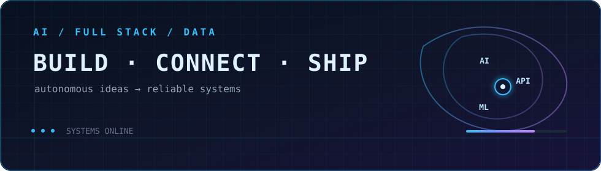
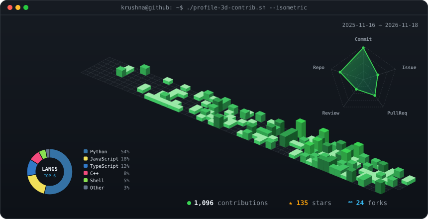
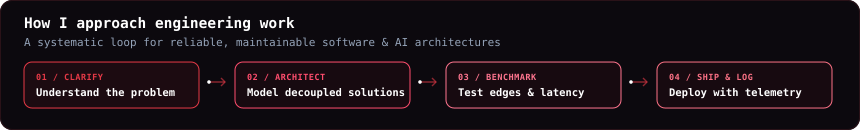

<!-- Hero Banner Card (Engineering Profile & Architecture Flow) -->

 

<!-- Dynamic Animated Typing Bar (Cyber Cyan Theme) -->

 

<table>
  <tr>
    <td valign="top"></td>
    <td valign="top">
      
    </td>
  </tr>
</table>

  

<!-- 3D Isometric Contribution Graph & Activity Radar -->

  

  

---

<a href="#about-me">About</a> ·
<a href="#engineering-focus">Focus</a> ·
<a href="#tech-stack--ecosystem">Stack</a> ·
<a href="#featured-projects">Projects</a> ·
<a href="#connect--collaborate">Contact</a>

 

### 🧠 About Me

> *"I enjoy building things — whether that's an ML model, an agentic AI system, a full-stack app, or a reliable data pipeline."*

I'm an **AI & Data Science** undergraduate at **Indira College of Engineering and Management (ICEM), Pune**. I am currently focusing on **machine learning, deep learning, AI systems, and MLOps**, while building full-stack applications and computer-vision projects.

- 🎓 **Education:** Pursuing **B.Tech in AI & Data Science** at ICEM Pune
- 🔭 **Building:** ML experiments, infrastructure monitoring, full-stack applications, and local voice-assistant automation
- 🌱 **Focusing on:** Machine learning, deep learning, MLOps, model deployment, computer vision, and AI workflows
- ⚡ **Approach:** Start with a working implementation, document the system, and test it incrementally

 

### 🎯 Engineering Focus

| Area | What I build |
| --- | --- |
| **Machine Learning** | Classification, regression, and predictive-maintenance experiments |
| **Deep Learning & AI** | Learning neural-network architectures, training workflows, and applied AI systems |
| **MLOps** | Exploring experiment tracking, model packaging, deployment, monitoring, and reproducible pipelines |
| **Computer Vision** | OpenCV-based vehicle counting and structural-defect image processing |
| **Web Development** | React, FastAPI, Express, TypeScript, Firebase, and Java web backends |

 

<!-- Core Engineering Pillars -->

 

---

### 🛠️ Tech Stack & Ecosystem

<table>
  <tr>
    <td width="28%" valign="middle" align="left">
      <b>⚡ Languages &amp; Runtimes</b> 
      Python, C++, C, Java, TypeScript, JavaScript
    </td>
    <td align="left">
      
    </td>
  </tr>
  <tr>
    <td width="28%" valign="middle" align="left">
      <b>🧠 AI, ML &amp; Computer Vision</b> 
      Scikit-Learn, OpenCV, Python ML
    </td>
    <td align="left">
      
    </td>
  </tr>
  <tr>
    <td width="28%" valign="middle" align="left">
      <b>🌐 Backend &amp; Web Frameworks</b> 
      FastAPI, React.js, Node.js, Express, Tailwind CSS, HTML5, CSS3
    </td>
    <td align="left">
      
    </td>
  </tr>
  <tr>
    <td width="28%" valign="middle" align="left">
      <b>🗄️ Databases &amp; Cloud Storage</b> 
      MySQL, Firebase, SQLite
    </td>
    <td align="left">
      
    </td>
  </tr>
  <tr>
    <td width="28%" valign="middle" align="left">
      <b>🛠️ DevOps, Systems &amp; Tooling</b> 
      Docker, Linux, Git, Android, VS Code, Postman
    </td>
    <td align="left">
      
    </td>
  </tr>
</table>

 

---

<!-- How I Approach Engineering Work (Workflow Loop) -->

 

---

### 🚀 Featured Projects

#### 🤖 [RAPHAEL-OS — Active Intelligence Operating System](https://github.com/Krishna009-pro/Raphael)
> `Python` · `PyQt6` · `Voice AI` · `Agent Architecture` · 
- Multimodal AI operating system with real-time voice interaction, screen analysis, system orchestration, and browser automation.
- Includes a tool execution layer, ACP subagent planning, persistent SQLite memory, a PyQt6 HUD, and a documented test suite.

#### 🔎 [ARGUS-Consumer — Evidence-Grounded Financial Screening](https://github.com/Krishna009-pro/argus-consumer)
> `Python` · `FastAPI` · `React` · `LLM Research` · 
- Converts public financial reports into source-linked observations and requires human verification before findings enter analysis.
- Uses deterministic Python screening, PDF evidence extraction, falsification and red-team panels, and optional LLM-assisted qualitative research.

#### ☁️ [Cloud-Native MLOps Automation Platform](https://github.com/Krishna009-pro/auto-mlops-aws-k8s)
> `Python` · `Scikit-Learn` · `AWS` · `Docker` · `Kubernetes` · 
- Implements CI/CD/CT/CM workflows for a Random Forest training and FastAPI serving pipeline.
- Uses GitHub Actions, Docker, AWS Lambda/S3/SNS/SSM, Kubernetes, quality gates, monitoring, and rolling deployments.

#### 🌦️ [SkyGuard-AI — Sensor Anomaly Detection](https://github.com/Krishna009-pro/SkyGuard-AI)
> `Python` · `Machine Learning` · `Deep Learning` · `AWS` · 
- Weather-quality and sensor-fault detection prototype that combines meteorological rules, Isolation Forest, an autoencoder, spatial consensus, and self-healing data recovery.
- Includes AWS data ingestion, root-cause diagnosis, uncertainty estimation, technical reports, and containerized evaluation tooling.

 

---

### ⚡ Problem Solving &amp; Competitive Programming

&nbsp;&nbsp;

 

---

### 📊 Real-Time GitHub Analytics

<!-- GitHub Stats & Velocity (Stars, Commits, PRs, Contributed-to) -->

 

---

### 📬 Connect &amp; Collaborate

  <b>Open to software engineering and AI/ML opportunities.</b> 
  Interested in full-stack development, applied machine learning, computer vision, and student or open-source collaborations.

  
  &nbsp;&nbsp;
  
  &nbsp;&nbsp;
  

 

<!-- Dynamic Cyber Architecture Footer Banner -->

  

<!-- Anime footer animation referenced from Epsilon-Alpha's profile -->

  

  

⚡ Built with pure SVG architecture & refreshed daily via GitHub Actions · Krushna Patil &copy; 2025–2026

